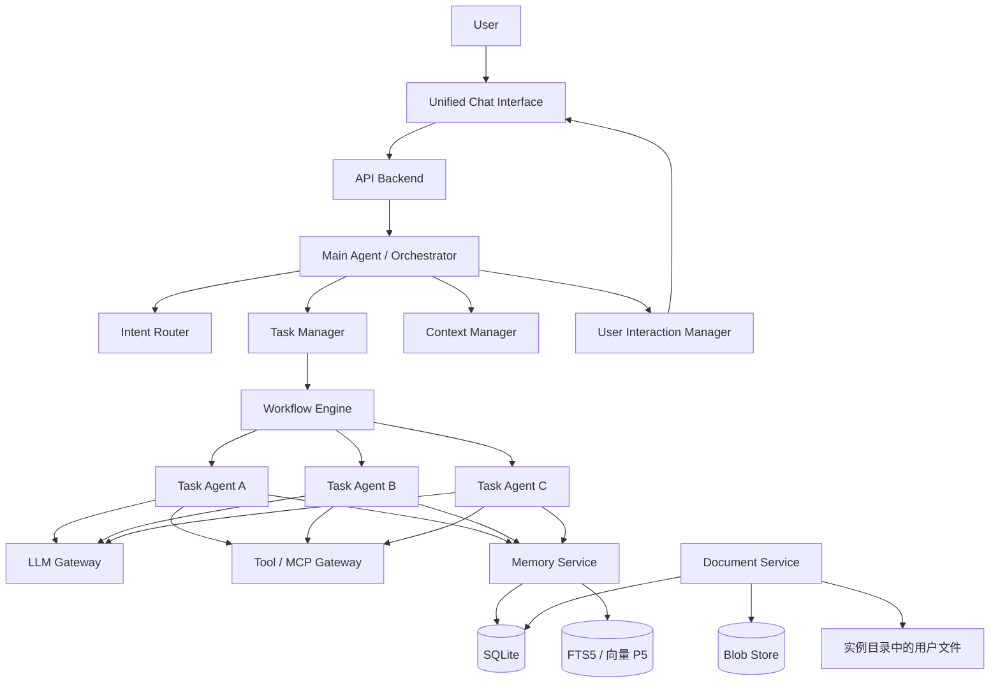
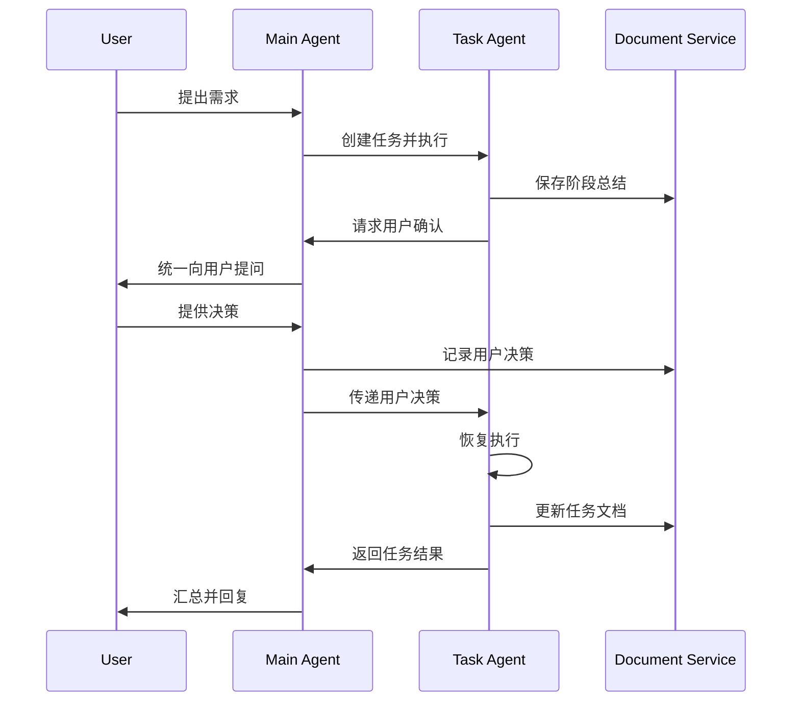
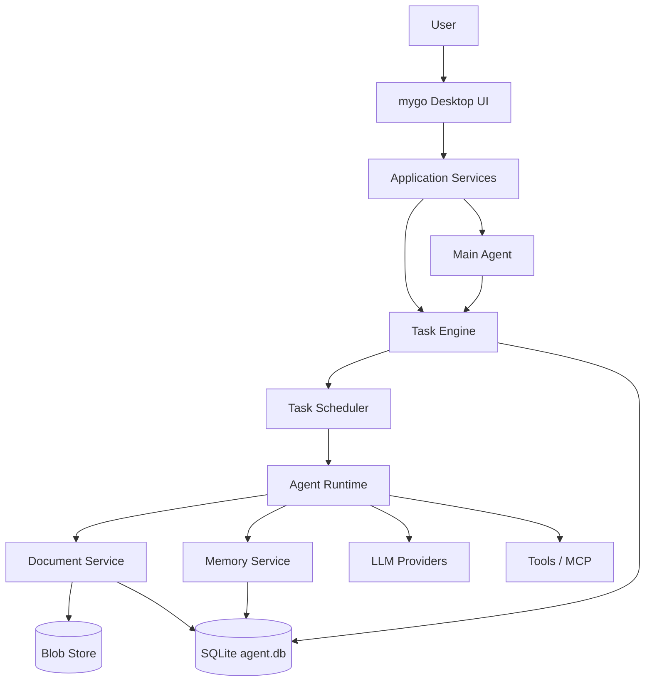

# Task-oriented Personal Agent 技术架构设计文档

**文档版本：** V1.3  
**产品定位：** 个人 AI 助手（Personal AI Agent）  
**产品形态：** 独立的桌面可执行文件 `task-agent.exe`（Go），每个实例打开一个目录，数据全部保存在该目录中  
**文档状态：** 架构概览（愿景、原则与领域概念）。数据模型、状态、事件、API 和实施计划以 `04-integration-and-mvp-plan.md` 为准，本文只保留概念说明并指向规范章节。  
**设计日期：** 2026-11-19

---

## 1. 项目概述

### 1.1 项目背景

当前主流大语言模型产品普遍采用 Chat-centric 模式，即以对话作为组织和管理工作内容的基本单元。

这种模式在简单问答场景下比较有效，但在复杂、持续、多阶段的工作场景中存在以下问题：

1. 不同工作主题的上下文混杂，容易造成上下文污染。
2. 长期任务持续消耗上下文窗口，历史信息管理困难。
3. 用户决策、方案选择依据和重要约束分散在聊天记录中。
4. 任务暂停后难以准确恢复。
5. 多个任务难以并行执行。
6. 任务成果缺乏系统化沉淀，难以复用。
7. 用户必须主动管理对话，无法自然地将工作交给 Agent。

本项目拟设计一种 Task-centric Personal Agent 架构，将任务作为系统内部的核心工作单元，同时保留统一的对话交互界面。

### 1.2 产品定位

本系统是一个面向个人用户的长期 AI 助手。

它不是简单的聊天机器人，也不是仅仅提供多 Agent 调度能力的开发框架。

系统的目标是成为用户的长期工作伙伴，能够理解用户的工作目标，组织和管理任务，持续积累工作成果，并在需要时恢复之前的工作。

用户只需要通过一个统一输入框与 AI 助手交流。

系统内部负责：

- 理解用户意图。
- 自动识别和创建任务。
- 为不同任务创建独立的执行上下文。
- 并行执行多个任务。
- 维护任务进度和历史信息。
- 记录用户决策及方案选择依据。
- 在任务需要用户参与时统一发起交互。
- 自动生成和更新任务文档。
- 在未来重新激活历史任务。

### 1.3 核心设计理念

**对话是交互入口，任务是执行单元，文档是长期记忆，主 Agent 是统一协调者。**

系统内部由一个 Main Agent 负责所有用户交互和任务协调。

每个 Task 拥有独立的执行上下文、运行状态、文档和决策记录。

任务的完整生命周期不依赖某个 LLM 服务商的会话机制。

### 1.4 产品核心能力

| 能力 | 说明 |
|---|---|
| 统一交互 | 用户始终面对同一个 AI 助手 |
| 自动任务管理 | 自动识别、创建和管理任务 |
| 上下文隔离 | 不同任务拥有独立上下文 |
| 多任务并行 | 多个任务可以同时执行 |
| 长期任务 | 支持跨天、跨周的持续任务 |
| 人机协作 | 通过主 Agent 统一向用户提问 |
| 决策沉淀 | 记录用户决策及其依据 |
| 文档沉淀 | 自动维护任务文档 |
| 任务恢复 | 支持暂停、恢复和重新打开 |
| 知识复用 | 不同任务可以引用已有成果 |
| 个人记忆 | 持续积累用户偏好和长期工作背景 |

### 1.5 第一阶段非目标

第一阶段不考虑：

- 多租户 SaaS。
- 企业组织管理。
- 多用户协作。
- 复杂角色权限体系。
- 企业级知识库管理。
- 大规模自治 Agent 集群。
- 无限制的 Agent 自主创建子 Agent。

架构允许未来扩展，但不为这些能力增加当前系统的复杂度。

---

## 2. 总体架构

### 2.1 架构概览

系统采用模块化分层架构。

主要分为：

1. Interaction Layer：用户交互层。
2. Orchestration Layer：主 Agent 编排层。
3. Task Execution Layer：任务执行层。
4. Memory & Document Layer：记忆和文档层。
5. Infrastructure Layer：基础设施层。



### 2.2 核心架构决策

#### ADR-001：采用个人单用户架构

系统围绕一个个人用户建立工作空间。一个工作空间就是一个目录：程序以目录为单位运行实例，数据全部保存在目录中（04 §2.4）。

第一阶段不需要复杂的用户、组织和租户管理。

核心实体关系：

```text
Personal Agent
    |
    +-- Personal Profile
    |
    +-- Global Memory
    |
    +-- Conversations
    |
    +-- Tasks
    |
    +-- Documents
    |
    +-- Knowledge Base
    |
    +-- Tools and Integrations
```

不同工作放在不同目录中，可以同时打开多个实例；同一目录同时只能有一个实例。一个数据库只属于一个实例，因此数据表中不需要 workspace_id。

#### ADR-002：主 Agent 与任务 Agent 分离

主 Agent 是唯一的用户交互代理。

任务 Agent 不直接面向用户，而是通过标准化消息与主 Agent 通信。

主要收益：

- 保持用户交互角色一致。
- 避免多个 Agent 同时向用户提问。
- 集中管理用户授权和确认。
- 便于统一管理任务状态。
- 支持不同模型和 Agent 实现。

#### ADR-003：Task 与 Session 解耦

Task 不等于 LLM Session。

一个 Task 可以包含多个 Session，一个 Session 也可以在不同执行阶段被替换或重新创建。

例如：

```text
Task: 企业知识库系统设计
│
├── Session 001：需求分析
├── Session 002：技术调研
├── Session 003：系统架构设计
├── Session 004：架构评审
└── Session 005：最终文档生成
```

Task 是长期存在的业务对象，Session 是执行过程中使用的上下文载体。

任务的完整状态不能依赖某个 LLM 服务商的会话 ID。

#### ADR-004：结构化数据与文档分离

结构化数据用于管理任务、状态、决策、依赖和事件。

文档用于保存完整的工作过程总结、分析报告、技术方案和其他成果。

不将所有信息简单地存储为聊天记录。

#### ADR-005：Workflow 与 Agent 分离

Agent 负责理解、推理、生成计划和执行工具调用。

Workflow 负责确定执行顺序、状态转换、等待、恢复、超时和重试。

不允许将关键业务流程完全交给 LLM 自由决定。

---

## 3. 核心领域模型

### 3.1 Personal Profile

个人用户档案是全局记忆的基础。

建议包含：

- 用户基本偏好。
- 常用语言。
- 工作习惯。
- 常用工具。
- 长期目标。
- 已确认的个人工作约束。
- 用户明确授权的个人信息。

这些信息应区分明确事实、用户偏好和模型推断。

模型推断的信息不能直接当作用户明确确认的事实。

### 3.2 Workspace

Workspace 是个人工作空间。

Workspace 在实现中就是一个实例目录。用户可以拥有多个目录（多个 Workspace），各自独立运行。

Workspace 包含：

- 主对话。
- 所有任务。
- 全局记忆。
- 任务文档。
- 个人知识库。
- 外部工具连接。
- 全局决策。

Workspace 是数据组织边界，不是任务本身。

### 3.3 Conversation

Conversation 是用户看到的主对话。

主要职责：

- 接收用户输入。
- 展示 Agent 回复。
- 展示任务状态。
- 展示需要用户确认的问题。
- 提供任务引用入口。

Conversation 不承担所有任务的详细执行上下文。

### 3.4 Task

Task 是系统最重要的业务实体，代表用户委托给助手的一项独立工作。

核心属性：来源对话、标题、目标、约束、状态、优先级、周期（cycle）、当前 Session、计划版本、进度。完整字段见 04 §4.3 `tasks`。

要点：

- 任务 ID 必须稳定，不因 Session 变化而变化。
- 每个 Task 至少包含一个 Task Node（可调度的执行步骤）；复杂任务包含多个节点和节点间的依赖（04 §3.1）。
- 计划和结果分别保存在 Task Node 的输入输出、文档和产物中，不再放在 Task 的 JSON 字段里。

### 3.5 Task Session

Task Session 代表某个任务中的一次独立执行上下文。

需要区分：

- Session：逻辑会话。
- Execution：一次具体执行（见 01 §4）。
- Checkpoint：执行过程中的持久化状态。

Session 应记录：

- 关联 Task。
- 使用的模型。
- System Prompt 版本。
- 上下文摘要。
- 开始和结束时间。
- Session 状态。

Session 需要支持归档和替换。任务状态不依赖任何模型供应商的会话 ID。

### 3.6 Task Decision

决策是具有独立生命周期的数据实体。

决策用两个维度描述（03 §7.1）：

- `decided_by`：USER（用户明确做出或确认）、AGENT（Agent 在授权范围内决定）、SYSTEM（按策略决定）。
- `status`：PROPOSED（提案）、PENDING_CONFIRMATION（等待用户确认）、CONFIRMED（已确认）、REJECTED（已否决）、SUPERSEDED（已被替代）。

被否决的备选方案记录在决策的 `alternatives` 中，不作为独立决策。

每条决策记录：

- 决策内容。
- 决策主体（decided_by）。
- 决策背景。
- 候选方案。
- 选择依据。
- 用户原始表达（如有）。
- 相关任务。
- 决策时间。
- 当前有效状态。
- 来源（用户消息或交互）。

必须保留原始决策记录，不能通过覆盖旧记录的方式更新决策；新决策通过 `supersedes_id` 替代旧决策。

### 3.7 Task Artifact

Artifact 表示任务产生的成果。

包括：

- Markdown 文档。
- PDF 文件。
- 代码文件。
- 数据文件。
- 图片。
- 架构图。
- 研究报告。

Artifact 应有版本信息、存储位置、创建者和关联任务。

### 3.8 Task Event

Task Event 是任务执行过程中的事件记录，用于审计、恢复和构建任务时间线。

事件命名统一为 `{aggregate}.{past_tense_verb}`，例如 `task.created`、`task.waiting_user`、`interaction.answered`、`decision.confirmed`、`document.updated`。完整事件清单见 04 §7.2。

## 4. Agent 架构设计

### 4.1 Main Agent

主 Agent 是用户唯一感知到的 AI 角色。

主要职责：

| 模块 | 职责 |
|---|---|
| Intent Understanding | 理解用户输入 |
| Task Routing | 判断请求所属任务 |
| Task Management | 创建、暂停、恢复任务 |
| Planning | 生成任务执行计划 |
| Agent Dispatch | 调度任务 Agent |
| Context Management | 组装任务上下文 |
| User Interaction | 统一向用户提问 |
| Result Synthesis | 汇总多个任务的结果 |
| Memory Management | 识别和管理重要信息 |

主 Agent 不负责所有耗时工作。

例如，用户要求调研五种数据库时，主 Agent 应创建任务并委派执行，而不是将所有研究过程放在主会话中。

### 4.2 Task Agent

每个 Task Agent 负责执行一个明确的任务目标（一个 Task Node）。

Task Agent 不是常驻的对象，而是 Agent Runtime 中的一次 Execution：

- 每次执行时从数据库装配上下文，不在内存中保存跨请求的状态（01 §1.3“Agent 无状态化”）。
- 通过内置工具报告进度、提交决策、更新文档、请求用户输入、声明完成或失败（04 §3.6）。
- 中断后从 Checkpoint 恢复（01 §11）。

Agent Runtime 的统一接口见 04 §6.4，不将业务逻辑绑定到特定模型厂商。

### 4.3 Agent 类型

第一阶段只实现两种逻辑角色：

- Main Agent。
- General Task Agent。

后续按需扩展：

- Research Agent。
- Coding Agent。
- Document Agent。
- Data Analysis Agent。
- Reviewer Agent。

不同角色可以采用不同 Prompt、工具权限和模型配置，但不必一开始就建立完全独立的 Agent 基础设施。

### 4.4 Agent 消息协议

Task Agent 与系统之间不使用自定义的消息格式，而是通过模型原生的 Tool Calling 调用内置工具（ADR-SI-021）。V1.1 中的消息类型与内置工具的对应关系：

| 原消息类型 | 现在的表达方式 |
|---|---|
| task_progress | `report_progress` |
| task_result / task_completed | `complete` |
| user_input_required | `request_user_input` |
| decision_proposed | `propose_decision` |
| artifact_created | `create_artifact` / `submit_document_update` |
| task_failed | `fail` |
| task_blocked | 由 Task Engine 根据依赖和外部条件判定，不由 Agent 声明 |

`request_user_input` 的参数示例：

```json
{
  "question_type": "BLOCKING",
  "title": "需要确认是否支持多租户",
  "question": "是否需要支持多租户？",
  "reason": "会影响权限模型和数据隔离设计",
  "options": [
    {"id": "yes", "label": "需要"},
    {"id": "no", "label": "不需要"},
    {"id": "unsure", "label": "暂不确定"}
  ]
}
```

内置工具的调用结果会持久化，并通过 Execution ID 和工具调用 ID 实现幂等（04 §6.9）。

### 4.5 用户交互代理机制

Task Agent 不直接与用户建立对话，而是向主 Agent 提交交互请求。



用户输入不能直接无条件发送给当前活跃的 Task Agent。

主 Agent 应先完成任务路由和必要的歧义判断。

---

## 5. 任务管理与状态机

### 5.1 任务生命周期

| 状态 | 说明 |
|---|---|
| CREATED | 已创建 |
| PLANNING | 正在制定计划 |
| READY | 等待执行 |
| RUNNING | 正在执行 |
| WAITING_USER | 等待用户输入 |
| BLOCKED | 被其他任务或外部条件阻塞 |
| PAUSED | 用户主动暂停 |
| REVIEWING | 结果检查 |
| COMPLETED | 已完成 |
| FAILED | 执行失败 |
| CANCELLED | 已取消 |

终态（COMPLETED、FAILED、CANCELLED）只能通过用户显式的 REOPEN 命令进入新周期（04 §3.7）。完整的状态转换表见 04 §5.1。

### 5.2 状态转换

状态转换图和转换表以 04 §5.1 为准。

每次状态转换必须经过 Task Engine 校验，并在同一事务中写入事件。

### 5.3 任务拆分

主 Agent 根据用户目标判断是否需要拆分任务。

任务类型：

- Simple Interaction：直接在主会话处理。
- Single Task：创建一个 Task。
- Composite Task：创建多个关联 Task。
- Long-running Task：创建可长期恢复的 Task。

不应将简单问答也创建成 Task。

任务拆分原则：

1. 目标具有相对独立性。
2. 输入和输出边界明确。
3. 可以独立执行或验证。
4. 具有独立上下文的价值。
5. 任务之间的依赖关系可以描述。

### 5.4 任务依赖管理

采用有向无环图（DAG）表示**同一 Task 内 Task Node 之间**的依赖。

```text
需求分析
   |
   +------> 技术选型
   |            |
   v            v
系统架构设计 <---+
   |
   v
架构评审
   |
   v
最终交付
```

依赖类型只支持 `FINISH_TO_START`：前置节点完成后，后置节点才能开始（02 §5.2）。

Task 与 Task 之间不建立调度依赖；需要使用另一个任务的成果时，作为“引用”由 Main Agent 显式授权读取（04 §3.1）。

调度器应识别循环依赖并拒绝创建无效依赖图（02 §5.3）。多节点计划和 DAG 调度在 Phase 4 实现。

## 6. 上下文管理与会话隔离

### 6.1 上下文分层

系统采用四级上下文结构。

| 上下文 | 内容 | 生命周期 |
|---|---|---|
| Global Context | 用户偏好、全局约束 | 长期 |
| Conversation Context | 当前主对话信息 | 对话生命周期 |
| Task Context | 任务目标、决策和相关材料 | 任务生命周期 |
| Execution Context | 当前执行过程的短期信息 | 单次执行 |

上下文之间采用按需加载机制。实现时的完整分层（含 System、User、Project、Retrieved Knowledge）和 Token 预算见 04 §10。

禁止所有 Task Agent 默认读取其他任务的完整上下文。

### 6.2 Task Context 组成

每次启动或恢复 Task Agent 时，Context Manager 组装：

```text
Task Context
│
├── Task Definition
├── Task Objective
├── Constraints
├── Execution Plan
├── Current Status
├── Relevant User Decisions
├── Latest Summary
├── Related Artifacts
├── Relevant Global Memory
└── Relevant Cross-task References
```

### 6.3 上下文压缩

不应仅依赖 LLM Session 历史维持长期上下文。

建议：

1. 保留近期消息。
2. 达到上下文预算阈值时触发摘要。
3. 将重要决策抽取为结构化记录。
4. 将任务成果写入文档。
5. 生成新的 Context Snapshot。
6. 必要时创建新的 Session。

摘要必须保留：

- 任务目标。
- 当前约束。
- 已确认决策。
- 决策依据。
- 已完成工作。
- 未解决问题。
- 当前执行计划。

摘要不是原始数据的替代品。原始消息和决策记录仍应保留。

### 6.4 任务恢复

恢复任务时，不建议直接将全部历史消息重新发送给模型。

```text
Task ID
   |
   v
Load Task State
   |
   v
Load Latest Checkpoint
   |
   v
Load Task Summary
   |
   v
Load Relevant Decisions
   |
   v
Load Relevant Documents
   |
   v
Build Context
   |
   v
Start or Resume Session
```

如果原 Session 不可恢复，则创建新 Session，通过任务文档和 Checkpoint 重建上下文。

---

## 7. 个人记忆与知识管理

这是个人 AI 助手区别于普通多 Agent 系统的重要能力。

### 7.1 记忆分类

概念上，系统中需要保存五类长期或半长期信息。它们在实现中分别落在不同的存储里：

| 概念 | 内容 | 实现方式 |
|---|---|---|
| User Memory | 用户长期偏好和工作习惯（输出格式、技术栈偏好、常用流程、明确约束） | `memories`，scope = USER_GLOBAL，type = PREFERENCE / PROFILE / FACT |
| Global Knowledge | 跨任务的长期工作背景（长期项目、技术环境、全局规范） | `memories`（type = FACT / KNOWLEDGE）；长期项目在 P5 使用 PROJECT 作用域；可复用经验进入 Knowledge Base（P5） |
| Task Memory | 某个任务专属的上下文和成果 | 任务文档、产物，以及 scope = TASK 的记忆 |
| Decision Memory | 用户确认过的决策和选择依据 | `task_decisions`（Decision Service） |
| Execution Memory | 执行中的阶段信息、检查点和待办 | `agent_checkpoints`、执行步骤，不进入记忆表 |

记忆的类型、作用域、来源和状态见 03 §2 和 04 §5.7。

### 7.2 记忆写入机制

不是所有对话内容都应该写入长期记忆。

建议采用：

```text
Conversation Message
       |
       v
Memory Candidate Extraction
       |
       v
Classify Memory Type
       |
       v
Evaluate Importance
       |
       v
Check Existing Memory
       |
       v
Persist or Ignore
```

记忆信息需要区分：

- 来源（`source_type`）：EXPLICIT（用户明确表达）、CONFIRMED（用户确认了系统提取的内容）、INFERRED（模型推断）、OBSERVED（行为观察）、IMPORTED（导入）。
- 时效：临时有效的信息通过 `valid_until` 表达，或者只保存在 TASK 作用域。
- 生命周期（`status`）：CANDIDATE、ACTIVE、SUPERSEDED 等，见 04 §5.7。

对于重要用户偏好和长期约束，应避免仅凭一次模糊表达就写入为永久事实。

### 7.3 个人知识库

个人知识库是全局记忆的重要补充。

可以接入：

- 本地文件。
- Markdown 文档。
- PDF。
- 个人笔记。
- 项目资料。
- 用户授权的外部知识源。

建议采用混合检索：

1. 结构化查询。
2. 全文检索。
3. 向量检索。
4. 按需读取原始文件。

用户决策、任务状态和依赖关系必须通过结构化查询获得，不能依赖向量相似度推断。

---

## 8. 文档系统

### 8.1 文档设计原则

文档是 Agent 的长期工作记忆。

文档需要在任务执行过程中持续更新，而不是仅在任务完成时生成。

主要采用 Markdown 格式，结构化信息同时保存到实例的 SQLite 数据库。

### 8.2 任务目录结构

文档按“逻辑路径”组织，实际存储为不可变版本对象（04 §14.4）。用户在导出的 Markdown 工作区中看到的结构如下：

```text
memory/
  profile.md
  preferences.md
tasks/
  {task}/
    task.md
    plan.md
    summary.md
    decisions.md
    progress.md
    sessions/
      1.md
    artifacts/
      architecture.md
      research-report.md
```

存储目录是系统内部数据，用户通过 UI 或 API 编辑文档（04 §3.8）。

### 8.3 task.md

模板见 03 §9.1。

### 8.4 decisions.md

模板见 03 §9.4。`decisions.md` 由决策数据渲染生成，不直接编辑。

### 8.5 summary.md

结构见 03 §9.3，至少包含目标、已完成工作、已确认决策、仍然有效的约束、当前阻塞和下一步计划（03 §12.4）。

### 8.6 文档更新机制

文档更新由 Document Service 统一管理。

流程：

1. Agent 提交结构化文档更新请求。
2. Document Service 检查版本。
3. 进行冲突检测。
4. 写入新版本。
5. 生成 Artifact 或 Document Revision。
6. 发布文档更新事件。

避免多个 Agent 直接同时覆盖同一个 Markdown 文件。

共享文档采用乐观锁和版本号机制。

---

## 9. 个人文件系统与工具集成

### 9.1 设计目标

个人 AI 助手应当能够在获得用户授权的前提下使用个人文件和工具。

建议将文件系统和外部工具作为 Agent 的资源访问层，而不是直接耦合进 Agent Runtime。

### 9.2 文件系统

两类存储都在实例目录中：

- Agent Managed Storage：系统维护的任务文档和成果，保存在 `.task-agent/blobs/`，用户和 Agent 的文件工具都不能直接访问。
- User Connected Storage：实例目录中 `.task-agent/` 以外的用户文件。Agent 可以读取；写入默认需要用户逐次确认，可在本实例配置中放开（04 §6.9、§15.1）。

实例目录以外的文件不对 Agent 开放（P5 之后如有需要再单独设计授权目录）。

### 9.3 工具接入

建议通过 Tool Gateway 统一接入 MCP 和其他工具。

每个工具应定义：

- 工具名称。
- 输入 Schema。
- 输出 Schema。
- 权限级别。
- 是否产生外部副作用。
- 是否需要用户确认。
- 超时时间。
- 幂等策略。

权限分级：

- READ：只读。
- WRITE：写入。
- EXECUTE：执行。
- EXTERNAL_ACTION：产生外部副作用。

---

## 10. 数据库设计

数据库设计以 04 §4 为准，包括：

- 核心表清单及每张表的引入阶段（04 §4.2）。
- 完整 DDL：字段、约束、索引（04 §4.3）。
- 数据模型实施约束：主键、时间、枚举、外键、乐观锁、不可变记录（04 §4.4）。

数据一致性原则：

- Task 状态变化和事件在同一事务中写入 `events` 表。
- 决策记录关联原始消息或交互。
- Artifact 和文档版本使用版本号和内容哈希。
- 持久化消费者按 `consumer_offsets` 续读事件，处理逻辑幂等（04 §7.3）。

## 11. Workflow 与异步执行架构

### 11.1 技术方案

采用：

- Task Scheduler：进程内的调度循环，根据数据库状态推进任务、处理等待、重试和程序重启后的恢复；不保存业务事实（04 §14.2）。
- Task Engine：负责业务任务状态、调度条件和依赖。
- Agent Runtime：负责单次执行的循环、模型调用和工具执行（自研，见 04 §3.5）。

产品是单进程桌面程序，同一目录只有一个实例，因此不需要外部工作流服务。

### 11.2 Task Workflow

```text
TaskWorkflow
│
├── InitializeTask
│
├── BuildContext
│
├── GeneratePlan
│
├── ValidatePlan
│
├── ExecuteTask
│     │
│     ├── LLMCall
│     ├── ToolExecution
│     ├── DocumentUpdate
│     └── ProgressUpdate
│
├── WaitForUserInput
│
├── ResumeExecution
│
├── ReviewResult
│
├── GenerateFinalSummary
│
└── CompleteTask
```

任务拆分后，可通过 Child Workflow 实现子任务调度。

### 11.3 长时间任务

必须支持：

- 数小时执行。
- 跨天执行。
- 等待用户数天。
- 程序关闭后再次打开时恢复。
- 网络异常重试。
- 模型调用失败后的补偿。
- 用户主动暂停。

Workflow 不应依赖进程内存保存执行状态。

### 11.4 执行幂等性

每次模型调用和工具调用需要有唯一 Execution ID。

需要区分：

- LLM 请求超时。
- LLM 请求成功但结果未持久化。
- 工具执行成功但响应丢失。
- Workflow 重试。

对于具有外部副作用的工具调用，必须设计幂等键，避免重复执行。

---

## 12. 主 Agent 输入路由机制

### 12.1 路由目标

每次用户输入需要判断：

1. 普通聊天。
2. 创建新任务。
3. 继续已有任务。
4. 修改已有任务。
5. 查询任务状态。
6. 恢复暂停任务。
7. 对多个任务进行协调。
8. 需要用户澄清。

### 12.2 路由算法

采用混合路由。

第一层：显式任务引用。

用户明确提到任务名称或通过任务入口进入任务时，优先使用显式引用。

第二层：语义匹配。

从任务标题、摘要、最近消息和相关决策中检索候选任务。

第三层：LLM 判断。

根据用户输入和候选任务判断目标任务。

第四层：置信度控制。

| 置信度 | 处理方式 |
|---|---|
| >= 0.85 | 自动路由 |
| 0.60–0.85 | 结合上下文判断，必要时澄清 |
| < 0.60 | 向用户确认 |

上述数值是初始工程参数，需要通过实际使用数据校准。

### 12.3 避免错误路由

如果用户在一个任务完成后立即提出相关问题，可以优先考虑当前任务。

如果用户明确提到其他任务，则覆盖当前任务。

如果两个任务高度相关但目标不明确，应询问用户，而不是擅自选择。

---

## 13. 用户交互管理

### 13.1 交互原则

Task Agent 不直接发起用户对话。

它只能提交 User Interaction Request。

由 Main Agent 决定：

- 是否立即向用户提问。
- 是否可以通过已有信息解决。
- 是否需要合并多个任务的问题。
- 是否可以延迟提问。
- 是否允许其他任务继续运行。

### 13.2 问题优先级

| 类型 | 说明 |
|---|---|
| BLOCKING | 不回答就无法继续 |
| IMPORTANT | 会明显影响方案质量 |
| OPTIONAL | 可以使用合理默认值 |
| CONFIRMATION | 需要用户授权或确认 |

只有必要的问题才打断用户。

对于非关键问题，Agent 应先使用合理默认值，并在文档中标记假设。

### 13.3 用户回答路由

每个问题都必须具有独立 ID，并绑定：

- Task ID。
- Session ID。
- Question ID。
- 相关执行步骤。
- 原始问题。
- 选项。
- 回答状态。

用户回答后，通过 Question ID 找到对应任务，再恢复执行。

不能只依赖当前活跃任务进行回答路由。

### 13.4 多任务同时等待

当多个任务同时等待用户时，Main Agent 可以将非紧急问题合并展示。

但必须保留每个问题的原始任务关联。

用户一次回答可以影响多个任务，但必须明确记录具体影响范围。

---

## 14. 应用服务与界面交互

程序不提供 HTTP API。界面与各模块之间通过进程内的 Go 接口（应用服务）交互，接口定义见 04 §6，界面操作清单和实时更新机制见 04 §12。

界面通过进程内事件总线获得任务状态、执行进度和流式回复的实时更新。

## 15. 运行形态

### 15.1 运行形态

**独立的桌面可执行文件、单进程、模块化单体。**

- 程序是 `task-agent.exe`，在 `simple-agent` 仓库中构建，复用其模型接入和工具代码。
- 启动时打开一个目录（实例）；不同目录可以同时打开多个实例，同一目录同时只能有一个实例（操作系统文件锁）。
- 实例的全部数据（数据库、文档、产物、配置、日志）都保存在该目录的 `.task-agent/` 中，可以整体复制、备份或迁移。
- 没有服务端、数据库服务或容器；不监听网络端口。任务只在实例运行时推进，关闭后再打开时继续。

### 15.2 进程结构



所有组件都在同一个进程内；外部依赖只有模型供应商 API 和工具访问的网络资源。详细结构见 04 §2.3、§2.4。

### 15.3 组件

| 组件 | 第一阶段 |
|---|---|
| mygo 桌面界面 | 必需 |
| Main Agent | 必需 |
| Task Engine + Task Scheduler | 必需 |
| Agent Runtime | 必需 |
| SQLite（纯 Go 驱动） | 必需 |
| Blob Store | 必需 |
| 向量检索 | Phase 5 |
| MCP 适配器 | Phase 4 |

### 15.4 数据安全

个人 AI 助手会保存用户长期工作资料，因此需要特别注意：

- API Key 优先通过环境变量提供，配置文件中只写变量名。
- 个人数据与模型服务商之间的传输控制。
- 文件访问范围限制在实例目录内，且不能访问 `.task-agent/`。
- 任务文档备份。
- 数据导出。
- 用户主动删除能力。
- 工具操作授权。
- 敏感数据脱敏。

应提供数据备份和恢复机制（04 §15.3），避免单机故障造成长期记忆丢失。

## 16. 可观测性与运行质量

建议为每次用户请求生成 Trace ID，并贯穿：

Conversation → Main Agent → Task → Session → LLM Call → Tool Call → Document Update。

关键监控指标：

| 指标 | 说明 |
|---|---|
| Task Completion Rate | 任务完成率 |
| Task Failure Rate | 任务失败率 |
| Task Resume Success Rate | 任务恢复成功率 |
| Routing Accuracy | 任务路由准确率 |
| Context Reconstruction Success | 上下文重建成功率 |
| User Clarification Rate | 用户澄清频率 |
| Agent Latency | Agent 响应耗时 |
| Token Consumption | 模型 Token 消耗 |
| Document Update Success | 文档更新成功率 |
| Decision Extraction Accuracy | 决策抽取准确率 |

尤其需要对决策抽取和任务路由建立测试集，不能仅以模型生成效果判断系统质量。

---

## 17. MVP 实施计划

阶段划分、阶段目标和阶段验收以 04 §16 为准；可执行任务、依赖和任务级验收标准见 `05-implementation-backlog.md`。

| 阶段 | 目标 |
|---|---|
| Phase 0 | 工程基础 |
| Phase 1 | 单任务执行闭环 |
| Phase 2 | 任务等待与恢复 |
| Phase 3 | 文档、决策与记忆（MVP 完成） |
| Phase 4 | 多任务和复杂调度 |
| Phase 5 | 完整个人助手 |

## 18. 核心测试场景

| 编号 | 测试场景 | 预期结果 |
|---|---|---|
| T01 | 用户提出简单问题 | 主 Agent 直接回答 |
| T02 | 用户提出复杂任务 | 创建独立 Task |
| T03 | 用户同时提出两个任务 | 创建两个独立任务 |
| T04 | 用户继续之前的任务 | 正确路由到原任务 |
| T05 | 两个任务并行执行 | 上下文隔离 |
| T06 | Task Agent 请求用户输入 | 主 Agent 统一提问 |
| T07 | 用户回答某个问题 | 准确恢复对应任务 |
| T08 | 用户暂停任务 | 保存状态 |
| T09 | 程序关闭后重新打开 | 恢复执行 |
| T10 | Session 上下文过长 | 生成摘要并重建 Session |
| T11 | 用户推翻之前的决策 | 保留历史并更新当前有效决策 |
| T12 | 多任务存在依赖 | 按依赖关系执行 |
| T13 | 两个 Agent 同时更新文档 | 避免版本覆盖 |
| T14 | Agent 调用工具失败 | 按策略重试或进入失败状态 |
| T15 | 用户重新打开已完成任务（Phase 5） | 恢复历史信息并继续工作 |
| T16 | 用户修改长期偏好 | 更新全局记忆 |
| T17 | 用户授权接入个人目录 | 仅访问授权范围 |
| T18 | 用户导出个人数据 | 提供完整可迁移数据 |

---

## 19. 关键架构风险与应对

| 风险 | 应对措施 |
|---|---|
| 主 Agent 错误路由 | 多级路由、置信度控制、用户确认 |
| 上下文摘要丢失关键信息 | 决策结构化存储、原始消息保留 |
| 多 Agent 并发修改文档 | Document Service、版本控制 |
| 长任务执行中断 | 基于数据库状态的 Task Scheduler + Checkpoint |
| 模型 Session 不可恢复 | 通过 Task Snapshot 重建 |
| 任务数量膨胀 | 任务创建阈值和归档机制 |
| Agent 自行扩大任务范围 | 任务边界和验收标准约束 |
| 用户决策识别错误 | 保留原文、明确决策状态 |
| 工具重复执行 | 幂等键和副作用控制 |
| 跨任务信息污染 | 权限过滤和显式引用 |
| 长期记忆污染 | 记忆分类、来源追踪和确认机制 |
| 个人数据丢失 | 自动备份和恢复机制 |
| 模型服务商切换 | 统一 LLM Gateway 和独立上下文存储 |

---

## 20. 最终架构决策

本系统采用以下基础架构：

**Main Agent + Task Engine + Task Scheduler + Agent Runtime + Memory Service + Document Service + SQLite，打包为一个按目录多实例运行的可执行文件**

核心领域关系：

1. Conversation：用户交互对象。
2. Task：系统业务对象。
3. Session：任务执行上下文。
4. Workflow：任务执行控制机制。
5. Document：长期工作记忆。
6. Decision：独立管理的业务数据。
7. Memory：个人长期知识和偏好。
8. Artifact：任务交付成果。

产品层面遵循：

- 用户只有一个 AI 助手。
- Agent 内部可以有多个独立任务。
- 每个任务拥有独立的执行上下文。
- 任务可以持续运行、暂停和恢复。
- 任务过程中的重要决策必须结构化记录。
- 任务文档持续更新。
- 主 Agent 统一处理所有用户交互。
- 个人长期记忆可以被不同任务按需使用。

第一阶段采用模块化单体和单用户部署，不引入不必要的企业级复杂度。

后续可以在不改变核心领域模型的前提下，扩展多 Agent、个人知识库、外部工具和主动任务管理。

---

## 附录 A：技术参考

1. SQLite：WAL、FTS5、STRICT 表  
   https://www.sqlite.org/wal.html  
   https://www.sqlite.org/fts5.html  
   https://www.sqlite.org/stricttables.html

2. modernc.org/sqlite（纯 Go 的 SQLite 驱动）  
   https://pkg.go.dev/modernc.org/sqlite

3. mygo（仓库 `simple-agent` 使用的界面库，见 `docs/go-rebuild-plan.md`）

4. Model Context Protocol  
   https://modelcontextprotocol.io/

## 附录 B：架构决策记录

本文正文 §2.2 中的 ADR 编号如下。系统级的完整决策清单以 04 §22（ADR-SI-xxx）为准。

| ADR | 决策 | 当前结论 | 对应 04 |
|---|---|---|---|
| ADR-001 | 采用个人单用户架构 | 单用户；一个目录一个实例，可多实例运行 | ADR-SI-001、002、029 |
| ADR-002 | 主 Agent 与任务 Agent 分离 | Main Agent 是唯一的用户交互入口 | ADR-SI-003、004 |
| ADR-003 | Task 与 Session 解耦 | Task、Task Node、Session、Execution 分离 | ADR-SI-005 |
| ADR-004 | 结构化数据与文档分离 | SQLite 为事实来源，Markdown 为可读表达 | ADR-SI-008、009、010 |
| ADR-005 | Workflow 与 Agent 分离 | 进程内 Task Scheduler 推进任务，Agent 循环自研 | ADR-SI-014、015 |
| ADR-006 | 记忆管理 | 全局记忆与任务记忆分离，来源可追溯 | ADR-SI-011、020、027 |
| ADR-007 | 工具接入 | 统一经 Tool Gateway；P4 起支持 MCP | ADR-SI-013 |
| ADR-008 | 部署架构 | 独立可执行文件，单进程模块化单体，Go 实现 | ADR-SI-017、028、030 |
